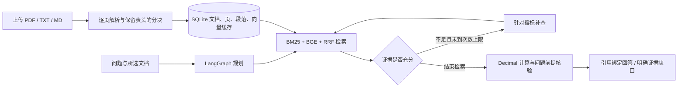

# 中文年报证据分析工作台

本功能基于 `kkkano/FinSight` 二次开发，入口 `/annual-reports`，集中展示上传资料的检索与核验能力。原 FinSight 的行情、投资研究和聊天流程保留。

## 本 fork 实现范围

2026-09-12：GitHub fork 已创建为 `Wyyyyuu/FinSight`；本地开发分支 `feature/annual-report-workbench`。
已实现以下能力，独立入口和主 API 共用同一个年报模块：

- PDF/TXT/Markdown 上传、逐页解析、SQLite 持久化与重复文件去重。
- 严格所选文档范围下的中文 BM25、真实中文语义向量与 RRF 混合召回。
- LangGraph 规划、检索、证据检查、有限补查、确定性计算、来源绑定回答。
- 前端上传、选择、分析、停止等待、证据原文查看和窄屏布局。
- 合成样例、真实中文年报解析与语义检索验证，以及独立 CI。
- 巨潮公开年报采集：按股票代码/年度发现全文、限速下载、核验、去重导入与批量分析。



## 独立运行

Python 3.11+、Node.js 20+。无需行情 API、数据库服务或 LLM 密钥即可完成证据摘录与数值计算。

```powershell
python -m venv .venv
.\.venv\Scripts\python.exe -m pip install -r requirements-annual.txt
npm ci --prefix frontend
$env:VITE_ANNUAL_REPORT_API_BASE_URL='.'
npm run build --prefix frontend
.\scripts\start-annual-reports.ps1
```

打开 <http://127.0.0.1:8001/annual-reports>。独立服务绑定本机，直接复用主 API 的年报 router；不会启动原平台行情调度器。前端构建时 `VITE_ANNUAL_REPORT_API_BASE_URL='.'` 表示年报 API 与网页同源，其他已有模块的 API 配置不变。

也可安装原项目 `requirements.txt` 后运行 `backend.api.main:app`，年报 API 已注册到同一主服务。远程访问必须接入原项目的已验证身份机制，工作区按用户分开；请求中的文档 ID 或会话 ID不能跨用户访问资料。无身份模式仅限本机访问。

## 真实语义检索

默认 BM25 模式无需模型下载。启用语义检索需要真实 `BAAI/bge-small-zh-v1.5` ONNX 模型；不使用哈希向量冒充语义向量。

```powershell
$env:ANNUAL_REPORT_MODEL_CACHE = Join-Path (Get-Location) '.annual-models'
.\.venv\Scripts\python.exe scripts/warm_annual_embeddings.py
.\scripts\start-annual-reports.ps1 -Semantic
```

模型不可用时会显式标记关键词回退，不能将其当作混合检索的测评结果。`/api/annual-reports/health` 返回模型是否实际加载及回退原因。模型缓存、上传文件和数据库已在 `.gitignore` 排除。

首次查询会计算并缓存所选报告的真实向量；长年报可能需要数分钟。向量默认按 8 条一批推理，`ANNUAL_REPORT_EMBEDDING_BATCH_SIZE` 可设为 1–32，CPU 线程默认 2。后续查询复用 SQLite 中的向量。无服务端任务队列；页面“停止等待”只中止浏览器请求，已开始的后台解析或索引可能继续完成。

## 模型辅助回答（可选）

同时设置 `ANNUAL_REPORT_LLM_BASE_URL`、`ANNUAL_REPORT_LLM_API_KEY`、`ANNUAL_REPORT_LLM_MODEL` 才调用兼容 Chat Completions API。未配置时使用“证据摘录”。回答的金额计算始终由 Decimal 完成，模型只选择来源中的原文片段；不在来源中的引文、伪造引用和模型错误会触发回退。密钥只放本机环境变量，不写入代码、浏览器或版本库。

### Agentic RAG 规划与补查（可选）

配置上述年报模型后，在启动年报服务的环境中设置 `ANNUAL_REPORT_AGENTIC_RAG_ENABLED=1`。服务默认使用原有检索与规则补查。`mode` 继续决定用 BM25 还是混合检索，后端在每个问题上自动选择以下路径。

| 问题和证据情况 | LangGraph 工作流选择 |
| --- | --- |
| 问题可用固定指标模板处理 | 按原问题做首轮检索，使用确定性金额和原因检查 |
| 问题含未覆盖的指标或分析要求，例如盈利质量、海外业务收入 | Agent 在首轮搜索前拟定至多 3 项取证要点和检索词，检索后按原文核对要点及原问题 |
| 证据齐备 | 直接计算和回答，跳过补查 |
| 常规查数缺证据，或 Agent 不可用 | 使用规则补查 |
| 固定模板的原因分析或复合比较，已选年报中有可定位的金额或原因缺口 | 首轮补查允许 Agent 选择一个缺口，生成一条检索词 |
| 开放题的原文未覆盖要点 | 预算允许时，采用 Agent 给出的检索词补查一轮，再核对证据 |
| 缺少所问公司的已选报告、数值口径冲突、已知前提不成立或首轮检索失败 | 由原规则处理，保留未解决的证据缺口 |
| 补查预算用完 | 结束检索，返回已核对的结果和剩余缺口 |

**是否进入 Agent 路径由后端规则决定。** 固定模板补查只发送问题和结构化缺口，模型选择一个候选并生成检索词。开放题规划发送问题与已选资料的公司和年度，之后的核对请求附带最多 18 段本次检索的原文，每段最多 1000 字。模型按要点返回原文摘录，程序验证来源编号和逐字引用，再展示核验后的摘录。开放题最多规划一次、核对两次、补查一轮。检索始终在用户所选文档及年度范围内，并计入原有预算。

开放题规划失败时，按原问题检索并标明规划未完成。核对失败或部分要点缺证据时，保留已有原文并报告缺口。固定模板的补查计划失败时，回到规则补查。

分析页的“分析过程”会显示路由理由、取证要点和核对进度。API 的 `metrics.retrieval_strategy` 区分 `standard`、`rule_supplement`、`agentic_supplement` 和 `agentic_planned`，每轮详情可在 `trace` 中查看。开放题的语义覆盖由模型评估，代码核验引用和资料范围，语义判断的质量需用真实问题评测。

### 本地意图识别（可选）

启用本地模型后的路由顺序是固定规则、MiniRBT v3、年报 LLM。固定模板直接进入证据与计算节点。模板未覆盖时，后端先从原句核对一家公司、一个明确财务年度和一个支持的金额指标，再让本地模型判定查金额、算同比或开放取证。口径限定、复合问题、低分或无法确定的候选交给 LLM。LLM 首轮可同时返回候选操作和取证清单，仍须通过相同的口径校验。分析过程和 `metrics.intent_source` 记录 `rules`、`minirbt`、`llm` 或 `unresolved`，显式选择其他本地模型时会显示对应模型名。

服务端使用 `requirements-annual.txt` 已含的 ONNX 推理栈，从本地目录加载模型。已有 MiniRBT v3 导出权重时，直接运行启动命令。首次训练见下文的 MiniRBT 扩大样本对照。

```powershell
.\scripts\start-annual-reports.ps1 -Intent
```

`-Intent` 默认选择 `.annual-models/annual-intent-minirbt-v3`。主后端通过 `ANNUAL_REPORT_INTENT_MODEL_DIR` 指定模型目录，启动脚本也接受显式目录。第三层在启动前设置 `ANNUAL_REPORT_AGENTIC_RAG_ENABLED=1` 和对应的三个年报 LLM 环境变量。已启动的服务如果无法加载本地模型，会把候选交给已启用的 LLM。LLM 不可用时保留未解决的意图和检索到的原文。

#### Qwen LoRA 微调

两个 Qwen 版本使用相同的 4,328 条训练问句和 556 条验证问句。分类头基线使用冻结的 Qwen3-0.6B-Base 特征。LoRA 版在后 12 层的注意力 Q、V 投影上训练 rank 8 的适配器，同时训练三分类头。按验证集选择第 4 轮，再合并适配器，导出 CPU INT8 ONNX，逐条校准部署阈值至 `0.50`。

微调环境需要 PyTorch、Transformers 和额外的 `peft==0.18.0`、`accelerate==1.12.0`。使用 `--device cuda` 时，训练环境需要能调用 CUDA 的 PyTorch。推理继续使用年报工作台原有的 ONNX 依赖。

```powershell
.\.venv\Scripts\python.exe -m scripts.train_annual_qwen_intent
.\.venv\Scripts\python.exe -m scripts.train_annual_qwen_intent --lora --device cuda
.\.venv\Scripts\python.exe -m scripts.eval_annual_intent --model .annual-models/annual-intent-qwen-lora --compare .annual-models/annual-intent-qwen --compare .annual-models/annual-intent-minirbt-v3 --suite v3 --out .annual-models/annual-intent-qwen-lora-v3.json
```

在 54 道 v3 留出题上使用同一批合成年报、相同口径校验和 BM25，并模拟远端 LLM 超时。

| 模型 | 本地答对 | LLM 规划请求 | 开放题误报完成 |
| --- | --- | --- | --- |
| Qwen 分类头 | 25 / 36 | 29 / 54 | 0 / 18 |
| Qwen LoRA | 29 / 36 | 25 / 54 | 0 / 18 |
| MiniRBT v3 | 30 / 36 | 24 / 54 | 0 / 18 |

另两套对照题上，Qwen LoRA 和 MiniRBT v3 的本地答对数分别为 23 / 24 对 23 / 24，以及 11 / 14 对 12 / 14。本机使用相同的 12 条问句测试热推理，CPU 分类耗时中位数分别为 200.2 ms 和 7.3 ms。这些历史权重可通过 `ANNUAL_REPORT_INTENT_MODEL_DIR` 显式加载。复制 Qwen 模型目录时需保留外部 ONNX 权重文件。

#### rsLoRA 与财务口径边界

rsLoRA 将低秩更新的缩放从 `α/r` 改为 `α/√r`。这版沿用后 12 层的 Q、V 投影，把 rank 从 8 提到 16，并将 `α` 设为 8，使两版实际缩放都为 2。共训练 986,115 个适配器和分类头参数。部署前将适配器合并到基座，再导出 CPU INT8 ONNX。[rsLoRA 论文](https://arxiv.org/abs/2312.03732)

新增成对样本，保留公司、财年和指标，修改报告期间、业务范围、同比基期或是否要求原因归因。4,904 条问句参与训练，278 条用于选轮次，422 条用于量化后的置信度校准。选轮次和校准按问法模板拆分，最终评测另有 12 对手写边界题。温度缩放只调整 softmax 的置信度，不改变类别排序。对 INT8 模型逐条推理拟合温度后，将缩放折入分类头，再根据验证集选择本地接题阈值。运行时仍核对公司、期间和指标，超范围或低置信度走 LLM。[温度缩放论文](https://proceedings.mlr.press/v70/guo17a.html)

```powershell
# CUDA PyTorch 环境中训练
python -m scripts.train_annual_qwen_intent --rslora --device cuda --train-only --adapter-dir .annual-models/annual-intent-qwen-rslora-adapter
# CPU PyTorch 环境中合并、量化和校准
python -m scripts.train_annual_qwen_intent --rslora --device cpu --adapter-dir .annual-models/annual-intent-qwen-rslora-adapter
.\.venv\Scripts\python.exe -m scripts.eval_annual_intent --model .annual-models/annual-intent-qwen-rslora --compare .annual-models/annual-intent-qwen-lora --compare .annual-models/annual-intent-minirbt-v3 --suite boundary --out .annual-models/annual-intent-qwen-rslora-boundary.json
```

指定 `--adapter-dir` 会单独保存 PEFT 权重和分类头。导出中断时可用同一个目录重跑，复用已有适配器与分类头。边界题同时统计两侧均分对的对数、模型把开放题判成查数的次数，以及经过工作台口径校验后的误报完成数。

| 留出题的本地正确数 | Qwen LoRA | Qwen rsLoRA | MiniRBT v3 |
| --- | --- | --- | --- |
| v3 主评测 | 29 / 36 | 30 / 36 | 30 / 36 |
| original | 23 / 24 | 22 / 24 | 23 / 24 |
| fresh | 11 / 14 | 12 / 14 | 12 / 14 |
| 财务口径边界 | 10 / 12 | 10 / 12 | 11 / 12 |

主评测中，rsLoRA 首轮 LLM 规划请求从普通 LoRA 的 25 / 54 降到 24 / 54。两种 LoRA 在边界题的原始分类中都判对 6 / 12 对，且都把 5 道开放题判成查数，经过范围校验后，两者误报开放题已完成均为 0 / 12。评测使用合成年报与模拟 LLM 超时。rsLoRA、样本增广和校准在同一版本引入，表中比较的是完整方案。

对同一份 INT8 权重单独比较温度缩放前后。拟合温度约为 2.32，主留出集的 NLL 从 0.489 降到 0.256，边界留出集从 1.145 降到 0.587，类别排序一致。同机用相同的 12 条问句比较热推理，rsLoRA 与 MiniRBT v3 的 CPU 分类耗时中位数分别为 47.9 ms 和 2.4 ms。

#### 成对问句续训

从上一版 rsLoRA 适配器和分类头出发，用较低学习率续训，混合 4,904 条普通训练问句与 288 对新问句。新问句保留指标与提问方式，改变调整口径、基期、比较对象或是否要求归因。两条问句进入同一批次，保留逐题交叉熵，同时计算两个方向的分差。查数题要求正确查数类别得分高于开放类别，开放题则要求相反。用较小的分差计算 hinge 惩罚，目标分差为 1。

把原权重纳入选轮次对照，先要求通过口径校验的普通验证题答对数最多下降 2 道，再按 72 对验证问句的两侧正确数选模型。导出后仍在独立校准集上拟合温度。原口径评测用于分析错因，新增的 `boundary-v2` 由 12 对新问句组成，和训练、选轮次、校准数据分开。[Contrast Sets 论文](https://aclanthology.org/2020.findings-emnlp.117/)

```powershell
# CUDA PyTorch 环境中续训
python -m scripts.train_annual_qwen_intent --paired --device cuda --epochs 2 --train-only --init-adapter .annual-models/annual-intent-qwen-rslora-adapter --adapter-dir .annual-models/annual-intent-qwen-rslora-paired-adapter
# CPU PyTorch 环境中合并、量化和校准
python -m scripts.train_annual_qwen_intent --paired --device cpu --adapter-dir .annual-models/annual-intent-qwen-rslora-paired-adapter
.\.venv\Scripts\python.exe -m scripts.eval_annual_intent --model .annual-models/annual-intent-qwen-rslora-paired --compare .annual-models/annual-intent-qwen-rslora --compare .annual-models/annual-intent-minirbt-v3 --suite boundary-v2 --out .annual-models/annual-intent-qwen-rslora-paired-boundary-v2.json
```

| 相同口径规则下的评测 | 原 rsLoRA | 成对续训 |
| --- | --- | --- |
| 原边界题两侧判对 | 6 / 12 | 11 / 12 |
| 新边界题两侧判对 | 9 / 12 | 8 / 12 |
| v3 主评测本地答对 | 30 / 36 | 27 / 36 |
| original 本地答对 | 22 / 24 | 20 / 24 |
| fresh 本地答对 | 12 / 14 | 10 / 14 |

续训在原边界题上把开放题误分为查数的次数从 5 降到 0，新题和常规题覆盖下降。另试在 422 条校准问句上降低开放类别的 logit，正确本地分流从 211 恢复到 221，但有 37 道开放题被模型改判为查数。Qwen 对照采用原 rsLoRA 权重，续训版保存在 `.annual-models/annual-intent-qwen-rslora-paired` 供复测。

排查还发现，一些明确同比问句被句式校验提前拦截。补充“一比”“高出”和句首“跟上年对照”等表达后，使用同一份原 rsLoRA 权重，v3 本地答对数从 30 / 36 到 31 / 36，original 从 22 / 24 到 23 / 24，原边界题从 10 / 12 到 11 / 12。两套边界题中的开放题均进入 LLM 规划。

#### 历史对照

历史训练脚本 `scripts.train_annual_intent` 默认导出 TinyBERT，也可用 `--model minirbt` 或 `--model mmbert` 导出其他模型。通过 `ANNUAL_REPORT_INTENT_MODEL_DIR` 可显式选择这些对照模型。

本地对照使用 40 道未参与训练和阈值选择的题。24 道预期可本地查数或计算，另有 16 道开放或限定口径的题。三组使用相同文档和证据检查，远端 LLM 模拟超时，记录首轮调用次数。

| 路由 | 本地答对 | 首轮 LLM 请求 | 开放题误报完成 |
| --- | --- | --- | --- |
| 关闭 TinyBERT | 5 / 24 | 35 / 40 | 0 / 16 |
| 启用 TinyBERT | 17 / 24 | 23 / 40 | 0 / 16 |
| 相同口径校验和查询改写，改用确定性分类 | 20 / 24 | 20 / 40 | 0 / 16 |

当前结果支持改进口径校验和同比表达处理。这个小规模合成评测里，TinyBERT 的本地正确覆盖低于同条件下的确定性分类，因此模型保持可选。结果只覆盖本地计算和分流，真实 LLM 的回答质量和线上延迟需另行评测。

mmBERT-small 在 CPU 上微调最后四层、最终归一化层和分类头。下面的命令对比已导出的 mmBERT 和 MiniRBT。将 `--suite fresh` 改为 `--suite original` 可以复测原来的 40 道题。

```powershell
.\.venv\Scripts\python.exe -m scripts.train_annual_intent --model mmbert
.\.venv\Scripts\python.exe -m scripts.eval_annual_intent --model .annual-models/annual-intent-mmbert --compare .annual-models/annual-intent-minirbt --suite fresh --out .annual-models/annual-intent-mmbert-fresh.json
$env:ANNUAL_REPORT_INTENT_MODEL_DIR = (Resolve-Path .annual-models/annual-intent-mmbert).Path
.\scripts\start-annual-reports.ps1 -Intent
```

使用同样的 630 条训练问句和 60 条阈值验证问句，分别在原来的 40 道题和新写的 22 道题上筛选。两组都用合成年报和实际 ONNX、BM25，远端 LLM 模拟超时。下表统计本地查数及计算的正确题数，以及首轮发给 LLM 的题数。

| 路由 | 原题本地答对 | 新题本地答对 | 原题转 LLM | 新题转 LLM |
| --- | --- | --- | --- | --- |
| 扩展规则 | 20 / 24 | 12 / 14 | 20 / 40 | 10 / 22 |
| MiniRBT | 19 / 24 | 12 / 14 | 21 / 40 | 10 / 22 |
| mmBERT | 19 / 24 | 11 / 14 | 21 / 40 | 11 / 22 |

三组都没有把两套题里的 24 道开放题误报为已完成。这次的 CPU 部分微调结果支持继续将 mmBERT 作为可选对照。新题用于额外筛选，仍需用真实用户问句验证实际覆盖。

#### MiniRBT 第二轮微调

`v2` 使用同一个固定版本的 MiniRBT-H256 基座。保留首轮问法，增加口语、指标在年份之前、比较基期在句首等表达，也加入境外营收、扣非利润、季度数据和附带原因分析等易混淆题。公司、财务年度和指标口径仍由代码核对。训练集、选轮次与阈值的验证集、最终对照题分开维护。

训练使用 1,563 条问句，AdamW 学习率为 `8e-5`，最多训练 5 轮。在 67 条验证问句上选中第 4 轮，置信度阈值为 `0.65`。v2 权重可用于与后续版本对照。

在新增的 26 道题上，旧权重配原句式校验本地答对 1 / 16，只换句式校验后答对 14 / 16，再换 v2 权重答对 16 / 16。首轮 LLM 请求数分别为 25 / 26、12 / 26 和 10 / 26。扩展规则对照同样答对 16 / 16。10 道开放题都保留给 LLM。对照用合成年报和实际 ONNX、BM25，远端 LLM 模拟超时。

```powershell
.\.venv\Scripts\python.exe -m scripts.train_annual_intent --model minirbt --profile v2
.\.venv\Scripts\python.exe -m scripts.eval_annual_intent --model .annual-models/annual-intent-minirbt-v2 --compare .annual-models/annual-intent-minirbt --suite v2 --out .annual-models/annual-intent-minirbt-v2-v2.json
```

#### MiniRBT 扩大样本对照

`v3` 使用 4,328 条训练问句和 556 条验证问句，并留出 54 道独立编写的最终对照题。新增问法涵盖年报口语表达、时间与金额单位、换口径取数、单季数据、比较对象变更以及复合问句。训练和验证使用不同的报告年度，训练、验证和新对照题之间没有完全重复的问句。标签仍为查金额、算同比和开放取证三类。

同一 MiniRBT-H256 基座全量微调 4 轮，标签平滑为 `0.03`。验证时先比较通过公司、财年和指标校验的正确本地任务数，再用开放题误判数和分类正确率选择权重。评测同时统计模型独立分类和完整工作流，规则、BM25 与金额计算沿用相同配置。

验证选中第 3 轮，阈值为 `0.65`。54 道留出题上，独立分类正确数从 v2 的 45 道提升到 v3 的 51 道，18 道开放题中被模型预测为固定取数的次数从 7 次降到 1 次。两版完整工作流均本地答对 30 / 36，均有 24 / 54 题转 LLM。两版使用相同的口径检查，测试用合成年报并模拟远端 LLM 超时。

```powershell
.\.venv\Scripts\python.exe -m scripts.train_annual_intent --model minirbt --profile v3
.\.venv\Scripts\python.exe -m scripts.eval_annual_intent --model .annual-models/annual-intent-minirbt-v3 --compare .annual-models/annual-intent-minirbt-v2 --suite v3 --out .annual-models/annual-intent-minirbt-v3-v3.json
```

## 使用与边界

### 抓取其他公司的公开年报

先启动工作台，再在第二个终端执行：

```powershell
.\scripts\start-annual-reports.ps1 -Semantic
# 第二个终端，仓库根目录：
.\.venv\Scripts\python.exe scripts/collect_annual_reports.py --codes 000651 600690 000921 --years 2024 --analyze
```

上述股票代码分别为格力电器、海尔智家和海信家电。脚本通过巨潮资讯公开公告查询接口动态发现年报，精确匹配股票代码、报告年度和完整中文年报标题，过滤摘要、英文版和更正说明；若存在完整修订版，采用搜索范围内最新披露版本。并非把固定 PDF 下载地址写死。当前覆盖沪深 A 股代码，每批最多 12 份报告。

外部请求至少间隔 1 秒，网络及 5xx 错误最多尝试 3 次；401/403/429 立即停止当前请求，不绕过登录或访问限制。不跟随外部重定向。附件仅从巨潮官方 HTTPS 域名下载，核对 PDF 签名、大小、页数、前五页的公司/股票代码与报告年度。接口改版、扫描件或识别不确定时会明确失败。

`--download-only` 只下载；`--analyze --mode bm25` 可不启用 BGE。默认导入本机 `http://127.0.0.1:8001`，通过现有上传 API 写入与页面相同的 `local` 工作区，无需手动再上传。导入后刷新页面即可选择这些真实公司。

文件和抓取记录保存在 `data/annual_reports/collected/`（不提交 Git）：

- `<股票代码>/<年度>/<公告编号>.pdf`：原始年报；同名 `.source.json` 记录来源。
- `manifest-<时间>.json`：公告标题、发布日期、来源 URL、首次下载时间、再次核验时间、SHA256、文档 ID、失败记录。
- `analysis-<股票代码>-<时间>.json/.md`：实际 LangGraph 逐公司分析结果，保留证据缺口和原始引用。
- `comparison-<时间>.md`：按计算结果生成的跨公司对照表，含每个数值的 PDF 页码链接；`comparison-latest.md` 为最近一次输出。

重复运行复用已有 PDF 和数据库文档，重新核验内容并保留首次下载时间。没有旧来源记录的历史缓存，其首次下载时间留空。抓取和入库成功不代表分析成功：任何下载/导入失败、证据不足或语义检索降级，脚本均返回非零退出码，已有成功结果保留。

已实际抓取的完整年报：

| 公司 | 年度 | 页数 | 公开来源 |
|---|---|---:|---|
| 格力电器 000651 | 2024 | 248 | [巨潮 PDF](https://static.cninfo.com.cn/finalpage/2025-04-28/1223330631.PDF) |
| 海尔智家 600690 | 2024 | 247 | [巨潮 PDF](https://static.cninfo.com.cn/finalpage/2025-03-28/1222926246.PDF) |
| 海信家电 000921 | 2024 | 243 | [巨潮 PDF](https://static.cninfo.com.cn/finalpage/2025-03-29/1222945858.pdf) |

本轮真实验证：新增 738 页、4,199 个文档块，已与原有美的年报一同出现在页面资料库。三家公司逐公司 hybrid 分析均为 `complete`，再与美的联合分析得到 8 项同比；共核验逐公司/联合结果中的 14 项计算，金额、年度及引用页绑定全部符合原文。重复采集复用三个原始 PDF，三个入库响应均为 `deduplicated=true`。本机记录见 `data/annual_reports/collected/collection-verification.json`，含解释的四公司对比见同目录 `家电行业2024年报对比.md`。

新检索流程按公司和报告年度分别召回，避免单家公司占满结果；最多 120 次检索、480 条证据。读取跨行指标名、表头百分比单位时保持严格匹配；必要的表头/单位/年度信息仅从同一原页恢复，不重写旧分块与向量。海尔复杂调整表仍拒绝猜测，通过第 41 页明确的本期/上年同期表读取金额，其 2023 年数值采用 2024 年报的调整后比较口径。

本轮集成后 `tests/annual_reports` 共 **206 项通过**，模块与 API 覆盖率 **92.50%**，Ruff 通过；原美的真实 PDF 验收仍为 3/3 用例、46/46 断言通过。浏览器实际连接本机后端，已验证四公司联合分析显示“证据充分 / 混合检索”及 8 项同比。以上为四份实际报告的验证，不代表通用业务准确率。

### 页面分析

1. 上传年报并填写公司与报告年度；选择本次允许检索的资料。
2. 输入问题，例如“比较 2023 年和 2024 年营业收入与经营现金流变化”。
3. 查看证据充分性、计算公式及对应来源；点来源打开物理 PDF 页文本。

页码为 PDF 物理页（从 1 开始），可能与印刷页码不同。TXT/Markdown 使用换页符分隔页面。扫描件需先 OCR；系统不会假装识别成功。复杂调整前/调整后表头、跨币种和缺少明确单位的数字保守拒算。当前确定性金额抽取支持营业收入、经营现金流净额、归母净利润三类指标，其他内容提供检索摘录。

上传年度是报告元数据，不代表每个数字都属于该年度。问题中的年份用于定位财务事实，允许从所选 2024 年报的明确比较列读取 2023 年数据；显式 API `years` 始终限制可检索报告的元数据年度。原因说明也核对公司和年度，不能拿其他年度的原因替代。所有补查保持所选文档集合不变，最多两次。

“加载示例”使用明确标注的虚构公司和合成数据，便于测试交互，不是实际财报或模型能力基准。真实测评必须使用独立标注的问题、来源页和正确值；测试通过不能直接转化为简历中的业务准确率。

## API

| 请求 | 用途 |
|---|---|
| `GET /api/annual-reports/health` | 工作区与模型配置状态 |
| `GET /api/annual-reports/documents` | 当前工作区资料 |
| `POST /api/annual-reports/documents` | Multipart：file、company、year |
| `GET /api/annual-reports/documents/{id}/pages/{page}` | 来源原文页 |
| `POST /api/annual-reports/demo` | 幂等导入合成示例 |
| `POST /api/annual-reports/analyze` | 问题、所选文档、可选年份与有界补查 |

## 验证

```powershell
.\.venv\Scripts\python.exe -m pip install pytest-cov ruff
.\.venv\Scripts\python.exe -m pytest tests/annual_reports -q --basetemp=data/annual_reports/test-tmp --cov=backend.annual_reports --cov=backend.api.annual_report_router --cov-report=term-missing --cov-fail-under=80
.\.venv\Scripts\python.exe -m ruff check backend/annual_reports backend/api/annual_report_router.py tests/annual_reports
npm run lint --prefix frontend
npm run test:unit --prefix frontend
npm run build --prefix frontend
npm run test:e2e --prefix frontend
```

PDF 单测需要 `reportlab`（主项目依赖已包含）；全新独立环境可执行 `pip install reportlab`。首次运行浏览器测试前，在 `frontend` 目录执行 `npx playwright install chromium`。

实际验证记录（Windows、Python 3.12，2026-09-12）：

| 验证 | 结果 |
|---|---|
| 年报模块与 API 自动测试 | 137 项通过，覆盖率约 94%，CI 下限 80% |
| 原核心请求理解、策略、回复契约与认证回归 | 95 项通过 |
| 新增主 API 认证与用户隔离集成测试 | 4 项通过 |
| 上游 `backend/tests` 全量 GitHub 回归 | 1841 通过、19 失败、8 跳过；19 项均在未改上游后端复现，原因见下 |
| 前端单测 | 36 个文件，217 项通过 |
| 前端浏览器回归 | 42 项通过；最终文案调整后额外复跑年报 5 项通过 |
| Ruff / 前端 ESLint / 生产构建 | 通过；ESLint 有 3 条上游既有 warning，无 error |
| 浏览器连接真实独立后端 | 跨年计算、混合检索、来源原文弹窗验证通过 |
| 真实 PDF 与 BGE | 美的 2024 年报 295 页、1550 块；真实 512 维向量，非关键词回退 |
| 真实年报验收脚本 | BM25 与 hybrid 分别 3/3 用例、46/46 断言通过；hybrid 发生关键词回退即判失败 |

上游两项策略测试曾在依赖未安装完整时失败，补齐原项目数据工具依赖后，上述 95 项全部通过。未测试外部行情服务或有密钥的生成模型。

新增[年报工作台 GitHub CI](https://github.com/Wyyyyuu/FinSight/actions/runs/34678057087)已在 Linux 通过后端覆盖率门槛、前端单测、构建和浏览器测试。首轮整库 CI 在安装上游 `litellm==1.30.0` 时失败；当前代码无该库引用且本功能无需它，已移除这项失效依赖。

清理后[整库 CI](https://github.com/Wyyyyuu/FinSight/actions/runs/34678169412)成功安装依赖并执行 `backend/tests`：1841 通过、19 失败、8 跳过。19 个失败分布在 `test_langgraph_api_stub.py`、`test_phase5_no_double_routing.py`、`test_streaming_datetime_serialization.py`、`test_trace_and_session_security.py`，均为旧聊天端点在未配置 LLM 时先返回 503。相同四个文件在未修改后端的上游隔离检出中复现 19 失败、9 通过，确认不是年报改动引入。新年报独立入口的无密钥模式已单独验证通过。

### 可重复的真实年报验收

从[美的官方 2024 年度报告](https://www.midea.com.cn/content/dam/mideacn-aem/%E6%8A%95%E8%B5%84%E8%80%85%E5%85%B3%E7%B3%BB/%E6%8A%95%E8%B5%84%E8%80%85%E5%85%B3%E7%B3%BB%E6%96%87%E4%BB%B6%E6%80%BB%E8%A7%88/2024%E6%96%87%E4%BB%B6/%E7%BE%8E%E7%9A%84%E9%9B%A2-2024%E5%B9%B4%E5%B9%B4%E5%BA%A6%E6%8A%A5%E5%91%8A.PDF.coredownload.inline.pdf)下载 PDF，传给验收脚本。报告没有提交到 Git。

```powershell
.\.venv\Scripts\python.exe scripts/verify_annual_midea_2024.py --pdf 'C:\reports\midea-2024.pdf' --mode bm25
$env:ANNUAL_REPORT_MODEL_CACHE = Join-Path (Get-Location) '.annual-models'
.\.venv\Scripts\python.exe scripts/verify_annual_midea_2024.py --pdf 'C:\reports\midea-2024.pdf' --mode hybrid
```

脚本运行真实解析、检索、LangGraph 和计算；关闭生成模型调用及模型自动下载。输出到 `data/annual_reports/verification/midea_2024_smoke_result.json`，包含 PDF SHA256、每题状态、引用、耗时与逐项断言，失败返回非零退出码。

核验对象是物理第 9 页的原始财务表：2022–2024 年营收分别为 343,917,531,000 / 372,037,280,000 / 407,149,600,000 元；经营现金流分别为 34,657,828,000 / 57,902,611,000 / 60,511,572,000 元。四项同比应为 8.18%、9.44%、67.07%、4.51%。另验证从新报告读取旧年比较列，以及纠正“2024 年现金流下降”的错误前提。

本机真实 HTTP 混合分析首次约 170 秒（包含整本报告建索引）；缓存后错误前提问题约 3.02 秒。最终脚本在缓存已有向量时，三个 hybrid 用例分别约 2.20 / 0.86 / 3.64 秒。耗时受硬件、报告、并行负载影响。这是单份报告的三个冒烟用例，不是泛化准确率，也不能作为线上业务指标。

## 作为项目经历时的准确范围

可描述为“基于开源 FinSight 二次开发中文年报证据分析工作台，实现中文混合检索、LangGraph 有界补查、财务表年度绑定、确定性计算与引用溯源”。差异点集中在文档 RAG 和数据核验，可与代码评审/修复型 Agent 项目形成互补；原平台的行情、图表和研究 Agent 应明确归于上游基础。

主要实现文件：`backend/annual_reports/`、`backend/api/annual_report_router.py`、`frontend/src/pages/AnnualReportsPage.tsx`。默认 SQLite 与应用进程内检索适合本机项目演示，尚无分布式索引、OCR、后台任务取消和大规模并发保证。
